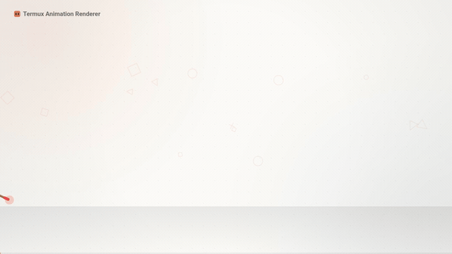

# 🎬 Termux Animation Renderer

[](https://github.com/EGO-CYBER/termux-animation-renderer/actions/workflows/ci.yml)
[](LICENSE)
[](https://termux.dev/)
[](https://nodejs.org/)
[](#-как-это-устроено)

**Превращает HTML/Canvas/SVG/WebGL-анимацию в MP4 прямо на телефоне.** Без ПК, без root, без Puppeteer и Playwright: только Chromium (через Chrome DevTools Protocol) и FFmpeg.

```
animation.html (написала нейросеть) → Chromium → кадры → FFmpeg → video.mp4
```

Вы описываете видео нейросети ([готовый промт](PROMPT_RU.txt)), получаете один файл `animation.html`, а программа сама читает из него разрешение, FPS и длительность и рендерит ролик.

---

## 🎞 Демо

<p align="center">
  
</p>

<p align="center">
  <a href="assets/demo.mp4">▶ Открыть MP4 в полном качестве (1920×1080, 30 fps)</a>
</p>

> Демо-ролик: анимацию написал **Claude Sonnet 5.5**, видео собрал этот рендерер на Android.

```html
<script>
  window.VIDEO = { width: 1920, height: 1080, fps: 30, duration: 30 };
  window.renderFrame = function (time) { /* рисуем кадр */ };
</script>
```

<p align="center"><sub>исходник ролика — <a href="examples/demo_2.0.html">examples/demo_2.0.html</a></sub></p>

---

## ✨ Возможности

| | Возможность | Подробности |
|:--:|---|---|
| ⚡ | **Параллельный рендер** | Несколько вкладок Chromium; число потоков подбирается по ядрам и свободной памяти |
| 💾 | **Кадры без диска** | Кадры идут сразу в FFmpeg — PNG не копятся (рендер 1080p больше не занимает ~1 ГБ временно) |
| 🛡 | **Защита от зависаний** | Вкладки обновляются, зависшие кадры перезапускаются, «хвост» на 97–99 % больше не тормозит финиш |
| 📊 | **Прогресс с ETA** | Отдельное окно с оставшимся временем, уведомление и вибрация по готовности (нужен `termux-api`) |
| 🔍 | **Проверка до рендера** | Ищет `Date.now`, `Math.random`, CDN и CSS-анимации; сравнивает кадры на детерминизм |
| 🤖 | **Ошибка «для нейросети»** | При сбое печатает готовый текст с номером строки — вставьте в чат, модель починит код |
| 🎚 | **Гибкость рендера** | Предпросмотр кадра, черновик (½ разрешения), motion blur, звук в MP4, очередь из файлов |
| 🖥 | **Графика** | WebGL (программный SwiftShader), Canvas 2D, SVG |
| 🔋 | **Wake lock** | Android не убьёт долгий рендер; готовое видео сразу появляется в галерее |

---

## 🚀 Установка

Одной командой:

```bash
pkg install -y git curl
curl -fsSL https://raw.githubusercontent.com/EGO-CYBER/termux-animation-renderer/main/install.sh | bash
```

Или из скачанного архива / клона:

```bash
bash install.sh
```

> Установщик ставит только недостающее, проверяет, что Chromium **реально запускается**, переносит проект в `~/termux-animation-renderer` (из «Загрузок» запускать файлы нельзя), создаёт команду `anim` и делает самопроверку. Его безопасно запускать повторно.
>
> Чтобы видео попадало в галерею, один раз выполните `termux-setup-storage`.

**Требования:** Android с Termux, Node.js 18+, Chromium, FFmpeg. Около 1 ГБ свободного места.

---

## ▶️ Использование

```bash
anim                                   # меню
anim render animation.html -o my_video # рендер одной командой
anim preview animation.html -t 5       # один кадр на 5-й секунде
anim render animation.html --draft     # черновик: быстро, половина разрешения
anim render animation.html --blur 4    # motion blur (в 4 раза дольше)
anim render animation.html --audio music.mp3
anim queue a.html b.html c.html        # несколько файлов подряд
anim selftest                          # проверка всей цепочки
anim clean                             # убрать временные файлы и зависший Chromium
anim update                            # обновить программу
```

Попробуйте на примере: `anim render ~/termux-animation-renderer/examples/demo.html`.

| Параметр | Значение |
|---|---|
| `-o, --output` | имя видео (по умолчанию имя html-файла) |
| `--dir` | папка сохранения |
| `--draft` | черновик |
| `--fast` | кадры в JPEG: быстрее, малые потери |
| `--blur N` | motion blur, 1–16 подкадров |
| `--audio` | звуковая дорожка |
| `--threads N\|auto` | число вкладок |

**Настройки** (меню → «Настройки», файл `config.json`): папка вывода, preset и CRF FFmpeg, число потоков, motion blur, формат кадров, уведомления. Разрешение, FPS и длительность в настройках нет: они задаются внутри самого `animation.html`.

---

## 📄 Формат animation.html

```html
<script>
window.VIDEO = { width: 1920, height: 1080, fps: 30, duration: 15 };  // audio: "music.mp3" — по желанию
window.renderFrame = function (time) {
    // time в секундах; полностью нарисуйте кадр
};
</script>
```

Кадры рендерятся параллельно и вразнобой, поэтому кадр **должен зависеть только от `time`**: без `Date.now()`, `performance.now()`, `requestAnimationFrame`, таймеров, CSS-анимаций и `Math.random()` без seed. Без интернета и CDN.

Подробности и готовый промт для нейросети: **[PROMPT_RU.txt](PROMPT_RU.txt)**.

### Примеры анимаций

| Файл | Разрешение | Длительность | Что показывает |
|---|---|---|---|
| [`examples/demo.html`](examples/demo.html) | 1280×720 | 15 с | базовые возможности, Canvas 2D |
| [`examples/demo_2.0.html`](examples/demo_2.0.html) | 1920×1080 | 30 с | полноценный ролик (источник демо выше) |
| [`examples/земля.html`](examples/земля.html) | 854×480 | 25 с | лёгкий пример для быстрой проверки |

---

## 🧠 Как это устроено

```
   anim → job.js ──► preflight: lint + проверка VIDEO/renderFrame + детерминизм
                         │
   Chromium (1 процесс, N вкладок, чистый CDP по WebSocket)
        │ кадры (PNG/JPEG), готовятся вразнобой
        ▼
   конвейер: выстраивает кадры по порядку, ограничивает буфер в памяти
        │ image2pipe
        ▼
   FFmpeg (libx264, yuv420p, faststart, звук) → video.mp4
```

| Модуль | Ответственность |
|---|---|
| `src/cdp.js` | клиент CDP (PUT `/json/new`, таймауты, детект падения вкладки, свободный порт) |
| `src/renderer.js` | preflight, конвейер кадров, защита от «хвоста», motion blur (`tmix`), запуск FFmpeg |
| `src/lint.js`, `src/report.js` | статическая проверка и текст для нейросети |
| `src/selftest.js` | настоящая диагностика мини-рендером |
| `src/cleanup.js` | очистка при Ctrl+C и остатков после аварий |
| `src/termux.js` | wake lock, уведомления, галерея, буфер обмена |

---

## 🛠 Если что-то не так

| Проблема | Решение |
|---|---|
| `CANNOT LINK EXECUTABLE ... cannot locate symbol` | `pkg update && pkg upgrade -y && pkg reinstall chromium` (или запустите `install.sh`) |
| Долго на 97–99 % | Обновитесь до 2.0: зависшие кадры дублируются. Журнал: `TR_DEBUG=1 anim ...` → `~/tr-debug.log` |
| Вылеты по памяти | `--threads 2`, `--fast`, меньшее разрешение; `anim clean` |
| Видео не в галерее | `termux-setup-storage` |
| Нет уведомлений | `pkg install termux-api` и приложение Termux:API |
| `Permission denied` при запуске | Запускайте `anim` из `~/termux-animation-renderer` (установщик сам копирует проект) |

Проверка окружения одной командой: `anim selftest`.

---

## 🧪 Тесты и вклад

```bash
npm test
```

Тесты проверяют конвейер (порядок кадров, зависший «хвост»), сборку MP4 через pipe с motion blur, проверку кода и разбор команд.

Issues и Pull Request приветствуются — подробности в [CONTRIBUTING.md](CONTRIBUTING.md).

---

## 📜 Лицензия

[MIT](LICENSE). Если проект пригодился, поставьте ⭐.
